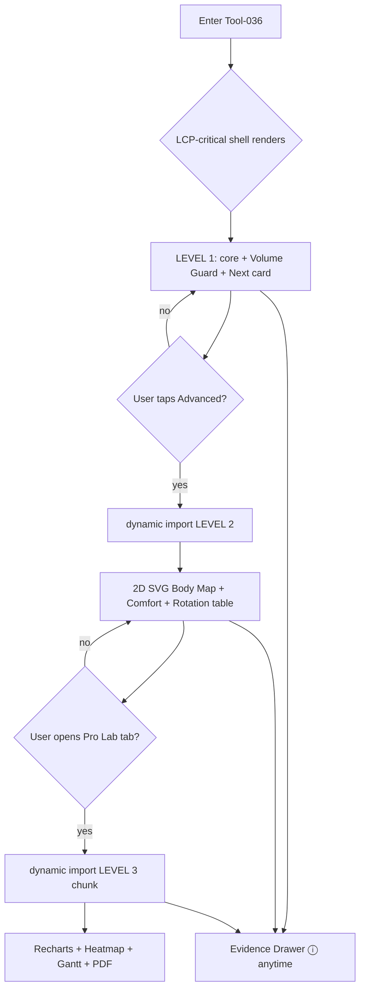
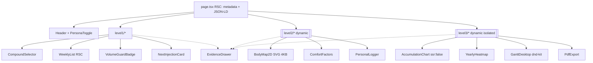
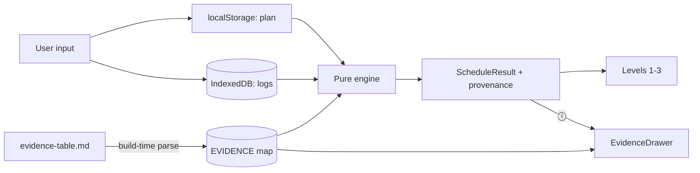

# Tool-036 — Wireframes (ASCII + Mermaid)

**Format:** Markdown-only (no Figma/Excel). **Viewports:** Mobile 375 px, Desktop 1440 px.
**Levels:** L1 (MVP/LCP) → L2 (Advanced/lazy) → L3 (Pro Lab/isolated).
Palette: `#0A0A0B` bg · `#00FF88` accent · `#FF3B30` danger.

---

## 1. LEVEL 1 — Mobile (375 px)

```
┌─────────────────────────────────────────┐ 375px
│ CHRONO-INJECT OS        [Tracking|Clin] │ ← header, persona toggle (44px)
│ Educational tool — not medical advice   │ ← L1 banner (persistent)
├─────────────────────────────────────────┤
│ COMPOUND                                │
│ ┌─────────────────────────────────────┐ │
│ │ Testosterone Enanthate        [▾]   │ │ ← selector (no lib)
│ └─────────────────────────────────────┘ │
│ ┌─────────────────────────────────────┐ │
│ │ + add compound                      │ │
│ └─────────────────────────────────────┘ │
├─────────────────────────────────────────┤
│ WEEK  (Sun / Thu)                       │
│  Sun  ● 0.5 mL   R gluteal    🟢        │
│  Thu  ● 0.5 mL   L gluteal    🟢        │
├─────────────────────────────────────────┤
│ VOLUME GUARD                     ⓘ      │ ← tap ⓘ → Evidence Drawer
│  ┌───────────────┬───────────────┐      │
│  │ 🟢 Common     │ 🟡 Limited    │ 🔴   │
│  │  ≤2 mL        │  2–5 mL       │>5 mL │
│  └───────────────┴───────────────┘      │
│  This week max/site: 0.5 mL             │
├─────────────────────────────────────────┤
│ NEXT INJECTION                          │
│  Sun · R gluteal · 0.5 mL               │
│  in 2 days                              │
├─────────────────────────────────────────┤
│ TOTAL 1.0 mL/week  ·  BUSIEST: Sun      │
├─────────────────────────────────────────┤
│        [  عرض التفاصيل المتقدمة ▾  ]     │ ← reveal L2 (lazy)
├─────────────────────────────────────────┤
│ Educational only · Sources: 37 · /evidence│ ← provenance line + link
└─────────────────────────────────────────┘
```

---

## 2. LEVEL 1 — Desktop (1440 px)

```
┌───────────────────────────────────────────────────────────────────────────┐
│ CHRONO-INJECT OS                                    [Tracking | Clinician]  │
│ Educational tool only — not medical advice.                                │
├──────────────────────────────┬────────────────────────────────────────────┤
│ LEFT COLUMN (form)           │ RIGHT COLUMN (result, sticky)              │
│                              │                                            │
│ COMPOUND                     │  WEEK — Sun / Thu                          │
│ ┌──────────────────────────┐ │   Sun ● 0.5 mL  R gluteal  🟢             │
│ │ Testosterone Enanthate ▾ │ │   Thu ● 0.5 mL  L gluteal  🟢             │
│ └──────────────────────────┘ │                                            │
│ + add compound               │  VOLUME GUARD                 ⓘ           │
│                              │   🟢 ≤2   🟡 2–5   🔴 >5                   │
│ ROTATION SITES               │                                            │
│ [x] R gluteal  [x] L gluteal │  NEXT INJECTION                            │
│ [x] R deltoid  [x] L deltoid │   Sun · R gluteal · 0.5 mL · in 2 days     │
│                              │                                            │
│         [ ADVANCED ▾ ]       │  TOTAL 1.0 mL/wk · BUSIEST Sun            │
│                              │ ────────────────────────────────────────── │
│                              │  Educational only · Sources 37 · /evidence │
└──────────────────────────────┴────────────────────────────────────────────┘
```

---

## 3. LEVEL 2 — Mobile (Advanced, lazy-loaded)

```
┌─────────────────────────────────────────┐
│ ← Advanced                [Tracking|Clin]│
├─────────────────────────────────────────┤
│ 2D BODY MAP            (8 sites)         │
│      ┌───────┐            ┌───────┐       │
│      │ Delt L│            │ Delt R│       │  ∅ 3D libs
│      └───────┘  ┌──────┐  └───────┘       │  tap ≥44px
│                 │ torso│                  │
│      ┌───────┐  └──────┘  ┌───────┐       │
│      │ Glut L│            │ Glut R│       │
│      └───────┘            └───────┘       │
│      ┌───────┐            ┌───────┐       │
│      │VastusL│            │VastusR│       │
│      └───────┘            └───────┘       │
│  ● green  ● yellow  ● red (healing)      │
│  [ عرض كل المواقع (16) ]                  │
├─────────────────────────────────────────┤
│ COMFORT FACTORS  (you record — no score) │
│  soreness  [ ] low [ ] med [ ] high      │
│  swelling  [ ]   bruising [ ]  leakage[ ]│
│  ⓘ Not a prediction. Your own logs only. │
├─────────────────────────────────────────┤
│ PERSONAL LOGGER   (12 logged)            │
│  R gluteal · 2d ago · soreness: low      │
│  L gluteal · 5d ago · —                  │
├─────────────────────────────────────────┤
│ 12-WEEK ROTATION (text)                  │
│  W1 Sun R gluteal · Thu L gluteal        │
│  W2 Sun L deltoid · Thu R deltoid        │
│  ...                                     │
└─────────────────────────────────────────┘
```

---

## 4. LEVEL 3 — Pro Lab (separate tab, isolated chunk)

```
┌─────────────────────────────────────────┐
│ ← Pro Lab                 [Tracking|Clin]│
├─────────────────────────────────────────┤
│ [ Chart ] [ Heatmap ] [ Plan ] [ Export ]│ ← tabs
├─────────────────────────────────────────┤
│ ACCUMULATION (8-week)                    │
│  ┌───────────────────────────────────┐   │  Recharts
│  │        ╱‾‾‾‾‾‾‾‾‾‾ (steady state)  │   │  ssr:false
│  │      ╱                            │   │  IntersectionObserver
│  │    ╱                              │   │  + Skeleton
│  │  ╱                                │   │
│  └───────────────────────────────────┘   │
├─────────────────────────────────────────┤
│ YEARLY HEATMAP  (GitHub-style)           │
│  Mo ░░▓▓░░▓▓▓░░ ...                       │
├─────────────────────────────────────────┤
│ PLAN — desktop: drag ⋮⋮ ; mobile: ↑ ↓     │
│  ⋮⋮ Sun R gluteal 0.5mL            ↑ ↓    │
│  ⋮⋮ Thu L gluteal 0.5mL            ↑ ↓    │
│  (drag disabled < 768px by design)        │
├─────────────────────────────────────────┤
│ [ Export PDF (QR → /evidence) ]           │
└─────────────────────────────────────────┘
```

---

## 5. EVIDENCE DRAWER

```
Mobile (bottom sheet)            Desktop (right panel)
┌────────────────────────┐       ┌──────────────────────────────┐
│ ⓘ EVIDENCE        [x]  │       │ EVIDENCE                  [x] │
├────────────────────────┤       ├──────────────────────────────┤
│ Claim   B01            │       │ Claim:  B01                  │
│ Value   ~5 mL max IM   │       │ Value:  ~5 mL max single IM  │
│ Conf.   ● Moderate     │       │ Confidence: Moderate         │
│ Source  Large-volume   │       │ Source: Large-volume IM …    │
│ URL     oncologynurse… │       │ URL: …                       │
│ Year    2019           │       │ Confidence colour-coded;     │
│ Quote   "5 mL has…"    │       │ Low always visible.          │
│ Checked 2026-10-17     │       │                              │
│ Uncert. upper figure…  │       │                              │
├────────────────────────┤       ├──────────────────────────────┤
│ Educational only       │       │ Educational only             │
└────────────────────────┘       └──────────────────────────────┘
```

---

## 6. Responsive rules (375 / 768 / 1440)

| Breakpoint | Layout | Notes |
|---|---|---|
| `< 768` (mobile) | single column; Gantt **drag disabled** → ↑/↓ list | no hover; tap ≥44px |
| `768–1439` (tablet) | 1.5 column; drawer = bottom sheet | |
| `≥ 1440` (desktop) | 2 columns; drawer = side panel; Gantt drag enabled | |

---

## 7. Mermaid — progressive disclosure flow



## 8. Mermaid — component tree (ownership / load)



## 9. Mermaid — data flow (local-first)


