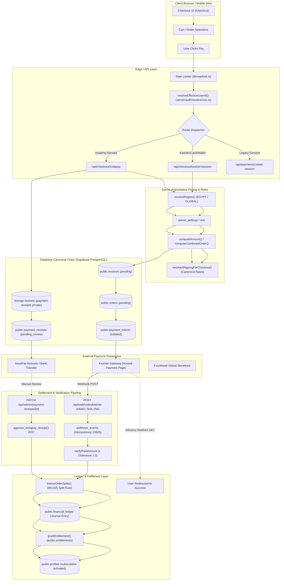
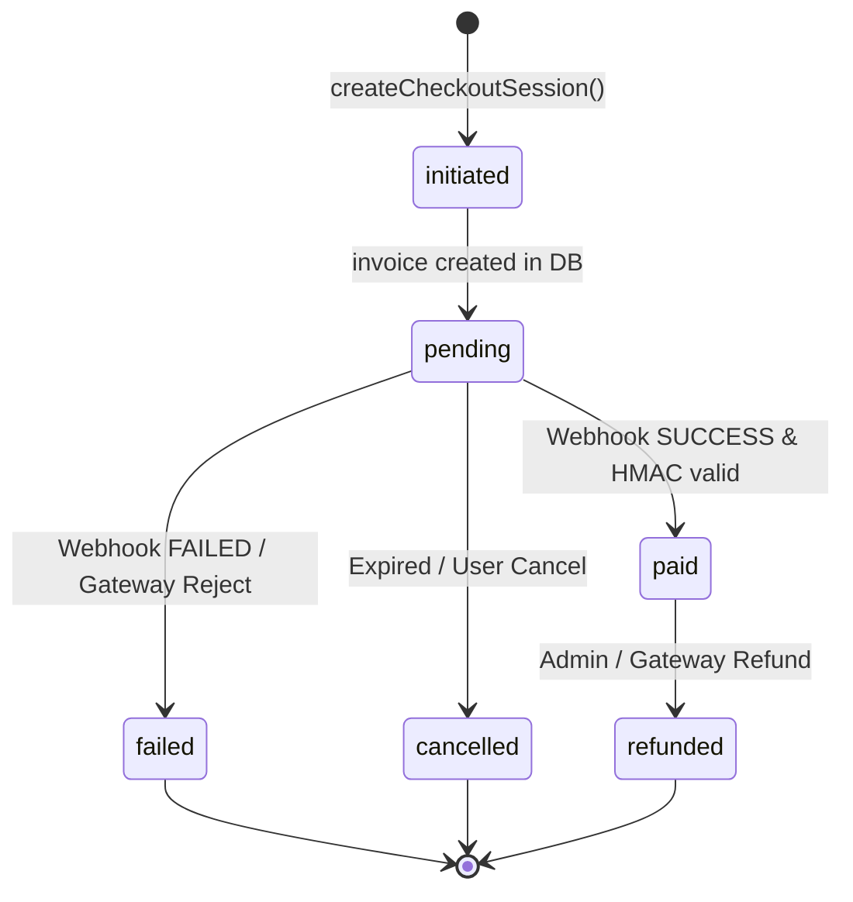
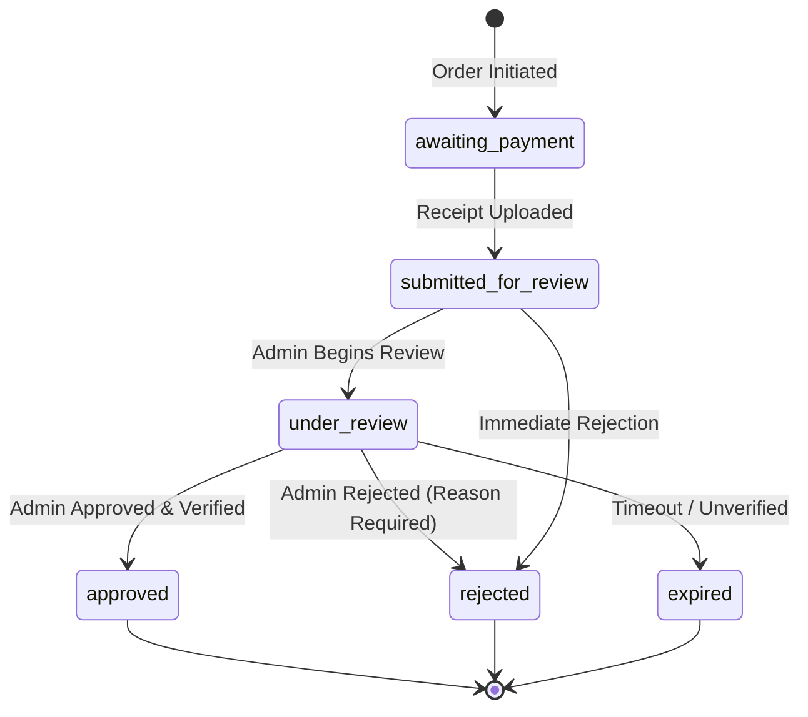

# MrXSteroid Payment Gateway — Architecture & Money Flow Map

**Audit Date:** 2026-10-18  
**Repository Commit:** `41dc2ad`  
**Scope:** Next.js App Router, Supabase PostgreSQL, Kashier, InstaPay, Fourthwall  

---

## 1. High-Level Money Flow Architecture

---

## 2. End-to-End Execution Trace

### Path A: Kashier Hosted Gateway Flow (Egypt / EGP)
1. **User Initiation:**
   - User selects tier (e.g. `MRX-PROTOCOL`) or combined cart on `/checkout`.
   - Client sends `POST /api/checkout/kashier/session` (or `POST /api/payments/create-session`).
2. **Identity & IDOR Verification:**
   - Endpoint calls `resolveEffectiveUserId(req, input.userId)` to enforce caller session token matches `userId`.
   - *(Note: Legacy `/api/payments/create-session` exhibits IDOR vulnerability PAY-003).*
3. **Server-Side Pricing Computation:**
   - Server resolves region using `resolveRegion()` (Egypt vs Global).
   - Authoritative prices loaded via `loadPricing()` from `admin_settings` database table, falling back to environment config and constants.
   - Client-supplied prices and currency are strictly ignored.
   - Shipping resolved server-side from carrier rules table (`resolveShippingForCheckout()`).
4. **Canonical State Instantiation:**
   - `invoices` row inserted (`payment_status = 'pending'`, `idempotency_key = <uuid>`).
   - `payment_intents` row inserted (`status = 'initiated'`).
   - `orders` row inserted linked to the invoice.
5. **Gateway Session Creation:**
   - `KashierGateway.createPaymentSession()` invokes Kashier API with order reference, amount, currency, and server webhook URL.
   - Session URL returned to client; client redirects to Kashier hosted checkout.
6. **Payment Capture & Webhook Processing:**
   - Customer completes card/wallet payment on Kashier.
   - Kashier issues `POST /api/webhooks/kashier`.
   - `webhook.ts` validates HMAC-SHA256 signature using `timingSafeEqual()`.
   - Idempotent insertion into `webhook_events`: if event ID already exists (`code === '23505'`), returns HTTP 200 immediately.
   - `verifyPaidAmount()` checks paid amount matches invoice amount within 1.0 currency unit tolerance.
7. **Settlement & Fulfillment:**
   - `freezeOrderSplits()` distributes net revenue using the Hare-Niemeyer Largest-Remainder method (85% Author, 10% Platform, 5% Reserve).
   - `recordPaymentPostingJournal()` commits entries to `financial_ledger`.
   - `invoices` updated to `payment_status = 'paid'`.
   - `payment_intents` updated to `status = 'succeeded'`.
   - `grantEntitlement()` inserts or updates `public.entitlements`.
   - `profiles` updated to activate subscription tier.
8. **Client Return:**
   - User redirected back to `/api/payments/callback` -> `/success`.

---

### Path B: InstaPay Manual Review Flow (Egypt / EGP)
1. **User Initiation & Receipt Submission:**
   - User transfers money via InstaPay application to the company bank account/VPA.
   - User visits `/checkout` and uploads receipt screenshot with transaction reference.
   - Client calls `POST /api/checkout/instapay` as `multipart/form-data`.
2. **Server-Side Pricing & Storage:**
   - Server re-calculates exact order total from server-authoritative prices.
   - Receipt image uploaded to Supabase Storage bucket `payment-receipts`.
   - Canonical `invoices`, `payment_intents`, `orders`, and `payment_receipts` created in `pending_review` state.
3. **Admin Review Queue:**
   - Admin accesses `/admin/payment-receipts`.
   - Admin verifies physical bank statement matches uploaded receipt image.
   - Admin triggers `PATCH /api/admin/payment-receipts/[id]` with status `approved` and verified `instapayReference`.
4. **Atomic Settlement Execution:**
   - Route executes database RPC `approve_instapay_receipt()`.
   - Receipt transitions to `verified`/`approved`.
   - Invoice marked `paid`, order marked `processing`.
   - Revenue splits frozen in `order_splits`.
   - Entitlements granted and user subscription updated.

---

## 3. Finite State Machine (FSM)

### Kashier Invoice State Machine

### InstaPay Receipt State Machine

---

## 4. Key Security Invariants & Verification Checklist

| Invariant | Status | Verification Evidence |
| :--- | :---: | :--- |
| **Server-Authoritative Pricing** | **PASSED** | Client prices/discounts strictly stripped in `computeAmount()` and `computeCombinedOrder()`. |
| **HMAC Timing-Safe Verification** | **PASSED** | `signatureMatches()` uses `crypto.timingSafeEqual()`. |
| **Webhook Idempotency** | **PASSED** | `webhook_events` uses unique constraint; duplicate event returns 200 without re-processing. |
| **Split Allocation Balance** | **PASSED** | `freezeOrderSplits()` enforces `totalAllocated === netAmountMinor` down to minor unit. |
| **Storage Privacy (Bucket)** | **DEFECT** | `uploadReceiptToStorage()` invokes `getPublicUrl()` on private bucket (`PAY-001`). |
| **Database RLS Coverage** | **DEFECT** | Missing `ENABLE ROW LEVEL SECURITY` on `invoices` table (`PAY-002`). |
| **RPC Search Path Isolation** | **DEFECT** | `approve_instapay_receipt` lacks `SET search_path = ''` (`PAY-004`). |
| **PL/pgSQL Code Integrity** | **DEFECT** | Variable name mismatch `v_net_amount_minor` breaks manual approval RPC (`PAY-005`). |
